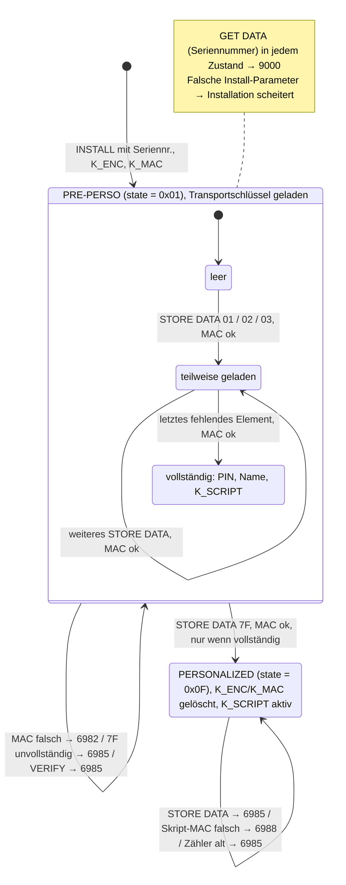
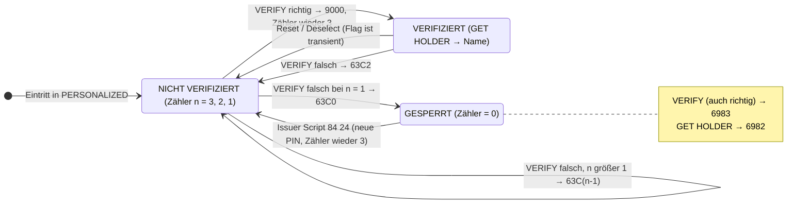

# 03 – Personalisierung (Zwischenübung)

Code: [`PersoApplet.java`](../src/main/java/playground/perso/PersoApplet.java) (Karte),
[`DataPreparation.java`](../src/test/java/playground/perso/DataPreparation.java) (HSM und Personalisierungsmaschine),
[`PersoAppletTest.java`](../src/test/java/playground/perso/PersoAppletTest.java) (Drehbuch).
Die Verwaltung nach der Ausgabe (K_SCRIPT) steht in [04-issuer-scripts.md](04-issuer-scripts.md).

## Was verschlüsselt ist und was nicht

- **Das Programm (OS, Applet) ist vor der Personalisierung schon auf dem Chip**,
  unverschlüsselt im ROM bzw. Flash. Es wird nicht „ausgepackt“.
- **Verschlüsselt transportiert werden die Personalisierungsdaten:** PINs, Schlüssel,
  Zertifikate, Karteninhaberdaten.
- Die Karte besitzt einen **kartenindividuellen Schlüssel**, abgeleitet aus einem
  Masterschlüssel des Herausgebers und der Seriennummer (**Key Diversification**). Er wird
  in der Vorpersonalisierung eingebracht. Damit entschlüsselt die Karte die Daten intern.

## Der reale Ablauf

| Phase | Wer | Was passiert |
|---|---|---|
| 0. Chipfertigung | Halbleiterhersteller | Chip mit OS, eindeutige Seriennummer, Transportschlüssel |
| 1. Vorpersonalisierung | Kartenhersteller | Applets laden/installieren (GP). Transportschlüssel durch kartenindividuelle Schlüssel ersetzen: `K_Karte = f(KMC, Seriennummer)` |
| 2. Datenaufbereitung | Herausgeber / Trust Center, **im HSM** | pro Karte PIN, Schlüssel, Daten erzeugen und unter dem Kartenschlüssel verschlüsseln. KMC verlässt das HSM nie. |
| 3. Elektrische Personalisierung | Personalisierungsmaschine | Seriennummer lesen, Kartenschlüssel im HSM ableiten, sicheren Kanal öffnen, `STORE DATA`. Karte prüft und entschlüsselt intern, danach PERSONALIZED, Transportschlüssel weg. |
| 4. Optische Personalisierung, Versand | | Druck/Laser. Karte und PIN-Brief **getrennt** versenden. |

Bei PKI-Karten kommt hinzu: Das Schlüsselpaar wird **auf der Karte erzeugt**, der
öffentliche Schlüssel geht an die CA, das Zertifikat wird zurückgeschrieben (Übung 3).

## Was die Demo nachbildet

- **Phase 1:** Seriennummer + K_ENC + K_MAC kommen über die **Install-Parameter**
  (GP-Format `[L][AID] [L][Privileges] [L][Applet-Parameter]`).
- **Phase 2:** `DataPreparation` leitet die Schlüssel ab und verschlüsselt bzw. MACt die Daten.
- **Phase 3:** `STORE DATA` (`80 E2`, wie bei GP). PIN und K_SCRIPT **verschlüsselt**,
  Name **nur MAC-geschützt** (nicht geheim). Der Abschluss sperrt jede weitere Personalisierung.

## Die APDUs

```
--> 80 CA 9F 7F 00                                   GET DATA (Tag 9F7F wie GP-CPLC)
<-- 12 34 56 78 9A BC DE F0 9000                     Seriennummer

--> 80 E2 01 00 20 │ A5 F1 FC 47 … 9C C3 │ 5C F8 D1 … 2A 1E    PIN, verschlüsselt + MAC
--> 80 E2 02 00 1E │ 4D 61 78 20 … 6E 6E │ A7 3E 30 … B9 52    "Max Mustermann" Klartext + MAC
--> 80 E2 03 00 20 │ 67 A4 79 6E … 72 86 │ 84 3F 26 … E5 5B    K_SCRIPT, verschlüsselt + MAC
--> 80 E2 7F 00 10 │                     │ B1 B4 53 … 12 4F    Abschluss, nur MAC
```

P1 = Tag des Datenelements. Daten = Nutzdaten || MAC (16 Bytes).

## Code-Walkthrough in Ablaufreihenfolge

### Phase 1: Schlüssel ableiten und installieren

`DataPreparation.deriveCardKey()`:
```java
byte[] block = Arrays.copyOf(serial, 16);                  // Seriennummer, auf 16 Bytes
return aes("AES/ECB/NoPadding", ENCRYPT, master, null, block);
```
Aus Kartenschlüssel und Seriennummer lässt sich der Master nicht zurückrechnen.
Ein geknackter Kartenschlüssel gefährdet nur diese eine Karte. Getrennte Master für ENC
und MAC: ein Schlüssel, ein Zweck. `40…4F` sind die GP-Default-Testschlüssel.

`PersoApplet.install()` parst die Install-Parameter als **LV-Struktur** (Länge lesen,
überspringen), bis AID-Position und Applet-Parameter feststehen.

Konstruktor:
- falsche Parameterlänge → Exception, die Installation scheitert vollständig
- `Util.arrayCopy(bArray, …, serial, …)`: `bArray` gehört der Runtime und ist nach
  `install()` ungültig, also kopieren
- `KeyBuilder.buildKey(TYPE_AES, …)` + `setKey()`: **Schlüssel sind Objekte**, keine
  Byte-Arrays (wie Schlüssel-Handles im HSM)
- `Cipher` und `Signature` (MAC) **einmal** anlegen, immer wiederverwenden
- `JCSystem.makeTransientByteArray(64, CLEAR_ON_DESELECT)`: Arbeitspuffer im **RAM**,
  damit Klartext nie im Flash landet

### Phase 2/3: Datenaufbereitung (Host)

PIN-Block `[Länge][PIN][00…]` (16 Bytes) wird mit K_ENC verschlüsselt (AES-CBC). Danach:
```java
macInput = tag || payload;                 // Tag ist im MAC!
mac      = cbcMac(kMac, macInput);         // ISO 9797-1 Padding Methode 2
APDU     = 80 E2 <tag> 00 Lc <payload || mac>
```
**CBC-MAC:** AES-CBC über die Nachricht, nur der letzte Block zählt.
**Padding Methode 2:** `80` anhängen, mit `00` auffüllen, und zwar immer, auch bei voller Blocklänge.

### Phase 3: `storeData()` auf der Karte

1. `state != PREPERSO` → `6985`. Das ist die erste Zeile und sperrt nach dem Abschluss alles.
2. Daten empfangen, **Länge prüfen** (Schutz vor Überlauf von `scratch`).
3. **MAC prüfen, bevor irgendetwas anderes passiert** (Encrypt-then-MAC): dieselbe
   MAC-Eingabe (Tag, Nutzdaten, Padding) in `scratch` bauen, `cbcMac.verify()` im
   `MODE_VERIFY`. Fehler → `6982`. Manipulierte Daten werden nie entschlüsselt.
4. Datenelement verarbeiten:
   - **Tag 01 PIN:** mit K_ENC entschlüsseln (nur hier existiert die PIN im Klartext, im RAM),
     Länge plausibilisieren, `pin.update()`, `scratch` **komplett** nullen.
   - **Tag 02 Name:** `Util.arrayCopy` (atomar, Ziel im Flash).
   - **Tag 03 K_SCRIPT:** mit K_ENC entschlüsseln, `kScript.setKey()` (Key Wrapping).
   - **Tag 7F Abschluss:** Vollständigkeit prüfen, `state = PERSONALIZED`, dann
     `kEnc.clearKey()`, `kMac.clearKey()`.

**Reihenfolge beim Abschluss:** erst Status umschalten, dann Schlüssel löschen. Ein
Stromausfall dazwischen hinterlässt eine gesperrte Karte mit ungenutzten Schlüsseln.
Umgekehrt wäre die Karte unbrauchbar („gebrickt“). Sauber löst man das mit einer
Transaktion (Übung 4).

### Phase 5: Nutzung

`verify()` und `getHolder()` wie in Übung 2, plus `state != PERSONALIZED` → `6985`.
Der Lebenszyklus **trennt die Funktionen strikt.**

## Was der Debugger zeigt

Ein Lauf mit Breakpoints in IntelliJ:

- **`install()`:** `bArray` = `06 F0…03 | 01 00 | 28 | 12 34 56 78 9A BC DE F0 | K_ENC | K_MAC`.
  IntelliJ zeigt Bytes vorzeichenbehaftet (`-16` = `0xF0`).
- **MAC-Eingabe (PIN):** `scratch` = `01 | A5 F1 … 9C C3 | 80 00…` → `macInputLen = 32`.
- **MAC-Eingabe (Name):** `02 | 4D 61 78 … 6E 6E | 80` → passt in einen Block (`16`).
- **Nach dem Entschlüsseln:** `scratch` = `04 34 37 31 31 00…` = „4711“, im Klartext nur hier.
  An Position 16–17 stehen noch **Reste der MAC-Eingabe** (`C3 80`). Deshalb wird der ganze
  Puffer genullt.
- **Abschluss:** vorher `state=1, kEnc=true, kMac=true`, nachher `state=15, kEnc=false, kMac=false`.

## Angriffstests

| Test | Ergebnis | Grund |
|---|---|---|
| 1 Bit im Kryptogramm gekippt | `6982` | MAC |
| Daten für andere Seriennummer | `6982` | andere Kartenschlüssel: Daten passen nur auf eine Karte |
| verschlüsselte PIN als „Name“ | `6982` | Tag ist im MAC |
| Abschluss unvollständig | `6985` | Vollständigkeitsprüfung |
| STORE DATA nach Abschluss | `6985` | Statusprüfung |

## Welche Schlüssel werden beim Abschluss vernichtet?

| Schlüssel | Ort | beim Übergang |
|---|---|---|
| KMC_ENC, KMC_MAC, KMC_SCRIPT (Master) | nur im HSM, nie auf der Karte | bleiben |
| K_ENC, K_MAC (Personalisierungs-/Transportschlüssel) | Karte | **gelöscht** |
| K_SCRIPT (Verwaltungsschlüssel) | Karte | bleibt |
| PIN, Name | Karte | bleiben (Zweck der Personalisierung) |

Das Löschen ist eine **zweite, unabhängige Sperre** neben der Statusprüfung. Selbst wenn
die Masterschlüssel später bekannt werden, ist die Karte nicht umpersonalisierbar.
Echte GP-Karten **wechseln** ihre Schlüssel meist (`PUT KEY` auf den operativen
Schlüsselsatz des Herausgebers), statt sie zu löschen.

## Was die Demo weglässt

- **Secure Channel (SCP02/SCP03):** `INITIALIZE UPDATE` (Challenges), Ableitung von
  Sitzungsschlüsseln (S-ENC, S-MAC, S-DEK), `EXTERNAL AUTHENTICATE` (gegenseitige
  Authentisierung), MAC-Chaining. Ohne das ist ein PIN-APDU **bei jedem Lauf identisch**
  und könnte vor dem Abschluss wieder eingespielt werden (Replay). Real gehören die
  Schlüssel außerdem der **Security Domain**, nicht dem Applet.
- **Ableitungsverfahren:** real z. B. GP/EMV-Verfahren bzw. NIST SP 800-108 bei SCP03.
- **Schlüsselübergabe Hersteller ↔ Herausgeber:** Key Ceremony, Transport unter einem KEK.
  Das ist typischerweise die Schnittstelle zwischen Kartenhersteller bzw. Sicherheitsdruckerei
  und dem Trust Center, das elektrisch personalisiert.

## Zustandsdiagramm: Lebenszyklus



Mermaid erlaubt keine Kanten aus einem inneren Zustand direkt in einen äußeren. Deshalb
geht der Abschluss vom Gesamtzustand PRE-PERSO aus, mit der Bedingung im Label.

## Zustandsdiagramm: PIN (innerhalb PERSONALIZED, `OwnerPIN`)



### Was die Diagramme zeigen

1. **Persistent vs. transient als Zustandsfrage:** `state`, die Ladeflags und der PIN-Zähler
   überleben einen Reset. Nur „VERIFIZIERT“ fällt beim Reset zurück.
2. **PERSONALIZED ist für die Personalisierung eine Einbahnstraße**, für den Herausgeber
   über K_SCRIPT aber nicht verschlossen.
3. **Kritische Kante:** Der Abschluss besteht aus drei Schreibvorgängen. Ein Stromausfall
   dazwischen erzeugt einen Zustand, der im Diagramm nicht vorkommt. Das ist Thema von Übung 4.
4. **GlobalPlatform** standardisiert die Idee: Applet INSTALLED → SELECTABLE →
   (applet-spezifisch, z. B. PERSONALIZED) → LOCKED. Karte OP_READY → INITIALIZED →
   SECURED → CARD_LOCKED → TERMINATED.

## Merksatz

> Bei der Personalisierung werden kartenindividuelle Daten über einen gesicherten Kanal in
> die Karte geladen. Die Karte hat aus der Vorpersonalisierung einen kartenindividuellen
> Schlüssel, den das HSM des Herausgebers aus Master und Seriennummer ableiten kann. Geheime
> Daten gehen verschlüsselt, alles integritätsgeschützt. Ein GP Secure Channel (SCP03) liefert
> zusätzlich Sitzungsschlüssel und Replay-Schutz. Nach dem Abschluss wechselt der
> Lebenszyklusstatus, und die Personalisierungsschlüssel werden gelöscht oder gewechselt.

## Zum Selbstausprobieren

1. In `dataPreparedForAnotherCardIsRejected` die „andere“ Seriennummer gleich der echten
   setzen: Was passiert?
2. Den Tag aus der MAC-Berechnung nehmen (Karte und `DataPreparation`): Welcher Test
   schlägt fehl, welcher Angriff klappt plötzlich?
