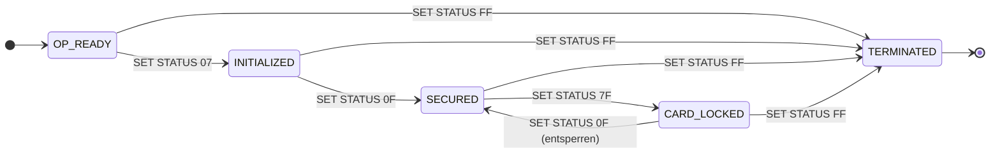

# 08 – GlobalPlatform: Security Domains, Lebenszyklus, SCP03

Code: [`GpCardEmulator.java`](../src/test/java/playground/gp/GpCardEmulator.java) (Karte),
[`Scp03Host.java`](../src/test/java/playground/gp/Scp03Host.java) (Host),
[`Scp03.java`](../src/test/java/playground/gp/Scp03.java) (KDF, CMAC),
[`GpCardTest.java`](../src/test/java/playground/gp/GpCardTest.java)

## Einschränkung vorweg

jCardSim hat **keinen GlobalPlatform Card Manager**. Die Issuer Security Domain ist hier eine
**Protokoll-Simulation** (Krypto mit BouncyCastle, deshalb unter `src/test`). Die SCP03-Details
(Ableitungskonstanten, Antwortaufbau, MAC-Kette) sind nach GP Card Specification Amendment D
**aus dem Gedächtnis umgesetzt**. Weil Karte und Host beide aus diesem Projekt stammen, beweisen
grüne Tests **nicht**, dass echte SCP03-Karten die APDUs akzeptieren. Für echte Karten:
[GlobalPlatformPro](https://github.com/martinpaljak/GlobalPlatformPro).

## Was GlobalPlatform regelt

Java Card legt fest, wie Applets **laufen**. GlobalPlatform legt fest, wie sie **verwaltet**
werden: wer laden, installieren, löschen, personalisieren und sperren darf, mit welchen
Schlüsseln und über welchen Kanal.

```
┌───────────────────────────────────────────────────┐
│ Applets           │ SSD (z. B. eines Dienstleisters)│
├───────────────────┴───────────────────────────────┤
│ Issuer Security Domain (ISD) = "Card Manager"      │  Schlüssel des Herausgebers, Lebenszyklus,
│ AID A0 00 00 01 51 00 00 00                        │  Register aller Applets, Secure Channel
├───────────────────────────────────────────────────┤
│ Java Card Runtime + VM                             │
└───────────────────────────────────────────────────┘
```

### Security Domains

| | Zweck |
|---|---|
| **ISD** (Issuer Security Domain) | Vertreter des Herausgebers auf der Karte, genau eine pro Karte, hält die Herausgeberschlüssel |
| **SSD** (Supplementary Security Domain) | eigener Bereich für Dritte (z. B. Anwendungsanbieter) mit eigenen Schlüsseln, eigener Secure Channel |
| **Delegated Management** | eine SSD darf mit Erlaubnis (Token) des Herausgebers selbst laden/installieren |
| **DAP Verification** | eine SD prüft eine Signatur (DAP) über den geladenen Code, bevor er installiert wird: Integrität und Herkunft des Applet-Codes |

### Privilegien (Byte 1)

| Bit | Wert | Privileg |
|---|---|---|
| b8 | `80` | Security Domain |
| b7 | `40` | DAP Verification |
| b6 | `20` | Delegated Management |
| b5 | `10` | Card Lock |
| b4 | `08` | Card Terminate |
| b3 | `04` | Card Reset (Default Selected) |
| b2 | `02` | CVM Management (globale PIN) |
| b1 | `01` | Mandated DAP Verification |

Die emulierte ISD meldet `9E` = Security Domain + Card Lock + Card Terminate + Card Reset + CVM Management.

### Lebenszyklus

**Karte:**
```
OP_READY (01) → INITIALIZED (07) → SECURED (0F) ⇄ CARD_LOCKED (7F)
        \______________ jederzeit ______________→ TERMINATED (FF), endgültig
```
- `OP_READY`/`INITIALIZED`: Produktions- und Vorpersonalisierungsphase
- `SECURED`: Betriebszustand beim Karteninhaber
- `CARD_LOCKED`: nur noch die ISD auswählbar, umkehrbar
- `TERMINATED`: Karte unbrauchbar, nichts mehr möglich

**Applets:** `INSTALLED (03) → SELECTABLE (07) → anwendungsspezifisch (z. B. 0F PERSONALIZED) → LOCKED (Bit 8 gesetzt)`.
Den anwendungsspezifischen Teil hat unser `PersoApplet` mit PRE-PERSO/PERSONALIZED selbst gebaut.



## Secure Channel Protocol 03 (SCP03)

Schlüsselsatz der ISD (mit Key Version Number, KVN): **K-ENC**, **K-MAC**, **K-DEK**
(DEK = Data Encryption Key, verschlüsselt z. B. neue Schlüssel bei `PUT KEY`).
SCP03 nutzt AES. Der Vorgänger SCP02 nutzte 3DES.

```
Host                                                    Karte (ISD)
 │  INITIALIZE UPDATE  80 50 KVN 00 08 <Host-Challenge>    │
 │ ──────────────────────────────────────────────────────▶ │  Karten-Challenge erzeugen,
 │                                                          │  Sitzungsschlüssel ableiten
 │  <Div.-Daten 10> <30 03 70> <Karten-Challenge 8> <Karten-Kryptogramm 8>
 │ ◀────────────────────────────────────────────────────── │
 │ Sitzungsschlüssel ableiten, Karten-Kryptogramm prüfen    │  → Host authentisiert die Karte
 │  EXTERNAL AUTHENTICATE  84 82 SL 00 10 <Host-Kryptogramm 8> <C-MAC 8>
 │ ──────────────────────────────────────────────────────▶ │  → Karte authentisiert den Host
 │  9000                                                    │
 │  84 F2 … <Daten> <C-MAC>   (MAC-Kette)                   │
 │ ──────────────────────────────────────────────────────▶ │
```

**Ableitungen** (KDF nach NIST SP 800-108, Counter-Modus, PRF = AES-CMAC,
Kontext = Host-Challenge ‖ Karten-Challenge):

| Wert | Schlüssel | Konstante | Länge |
|---|---|---|---|
| S-ENC | K-ENC | `04` | 128 Bit |
| S-MAC | K-MAC | `06` | 128 Bit |
| S-RMAC | K-MAC | `07` | 128 Bit |
| Karten-Kryptogramm | S-MAC | `00` | 64 Bit |
| Host-Kryptogramm | S-MAC | `01` | 64 Bit |

**C-MAC:** `CMAC(S-MAC, MAC-Kette ‖ CLA INS P1 P2 Lc ‖ Daten)`. Die ersten 8 Bytes gehen ins
APDU, alle 16 Bytes sind der nächste Wert der **MAC-Kette**. CLA trägt das SM-Bit (`84`), Lc
zählt den MAC mit.

**Security Level** (P1 von EXTERNAL AUTHENTICATE): `01` = C-MAC, `03` = zusätzlich C-DECRYPTION,
`33` = zusätzlich R-MAC und R-ENCRYPTION (Antworten geschützt). Die Emulation implementiert nur `01`.

**Was SCP03 löst**, was die eigene Personalisierungs-Demo nicht konnte:

| Problem | SCP03 |
|---|---|
| Replay | frische Challenges von **beiden** Seiten, Sitzungsschlüssel pro Sitzung, MAC-Kette |
| einseitige Authentisierung | **gegenseitig**: Karten- und Host-Kryptogramm |
| Umsortieren / Einfügen von Kommandos | MAC-Kette: jedes Kommando hängt vom vorherigen ab |
| Fehler bleiben folgenlos | jeder MAC-Fehler **beendet die Sitzung** |

## Der Trace

```
00 A4 04 00 08 A0 00 00 01 51 00 00 00                        SELECT ISD
80 50 00 00 08 38 D4 2F EC F9 35 F0 C3 00                     INITIALIZE UPDATE (Host-Challenge)
<-- 00 00 12 34 56 78 9A BC DE F0 | 30 03 70 | B1 78 F4 B6 10 C9 2E 7C | 69 3F 5F AA 0E B5 35 11
    Diversifizierungsdaten          KVN SCP i  Karten-Challenge          Karten-Kryptogramm
84 82 01 00 10 98 79 63 B9 C2 DE 60 62 | 4C 47 C4 DE 29 8E 30 63   EXTERNAL AUTHENTICATE
               Host-Kryptogramm          C-MAC
84 F2 80 00 0A 4F 00 5A 4D 2A C1 71 35 4C 52 00               GET STATUS ISD (4F 00 = alle, + C-MAC)
<-- 08 A0 00 00 01 51 00 00 00 01 9E                          AID, Lebenszyklus 01, Privilegien 9E
84 F2 40 00 0A 4F 00 …                                        GET STATUS Anwendungen
<-- 06 F0…0101 07 00 | 06 F0…0103 0F 00 | 06 F0…0104 07 00
```

## Tests

| Test | Ergebnis |
|---|---|
| Verwaltung ohne Secure Channel | `6982` |
| Handshake mit richtigen Schlüsseln | `9000`, Host hat die Karte authentisiert |
| Host mit anderen Schlüsseln | **Host** lehnt die Karte ab (Karten-Kryptogramm falsch) |
| altes EXTERNAL AUTHENTICATE in neuer Sitzung | `6300` (neue Challenges) |
| C-MAC verfälscht | `6982`, Sitzung danach geschlossen |
| exakt dasselbe MAC-APDU zweimal | zweites Mal `6982` (MAC-Kette) |
| Lebenszyklus vorwärts, sperren, entsperren | `9000` |
| SECURED → INITIALIZED | `6985` |
| TERMINATED | danach `6985` für alles, auch kein neuer Kanal |

## Was die Emulation nicht abbildet

- `INSTALL [for load]`, `LOAD`, `INSTALL [for install]`, `DELETE` (Code laden/löschen). Im
  Simulator werden Applets direkt installiert. `INSTALL [for personalization]` + `STORE DATA`
  (Personalisierung über die SD).
- `PUT KEY` (Schlüsselwechsel, neue KVN), Schlüsseldiversifizierung pro Karte (in der Praxis
  üblich, siehe Personalisierung: Master + Kartenkennung).
- SSDs, Delegated Management, DAP, Token, Receipts.
- C-DECRYPTION, R-MAC, R-ENCRYPTION, Pseudo-Zufalls-Challenges mit Sequenzzähler.

## Mit echten Karten: GlobalPlatformPro

Typische Aufrufe (Auswahl, Optionen mit `gp -h` prüfen):

```bash
gp -l                          # GET STATUS: Security Domains, Pakete, Applets
gp --install applet.cap        # LOAD + INSTALL
gp --delete <AID>              # DELETE
gp --lock <neuer Schlüssel>    # Standardschlüssel 40..4F durch eigenen ersetzen (PUT KEY)
```

Wichtig: Neue Entwicklerkarten haben die öffentlich bekannten Testschlüssel `40…4F`. **Der
erste Schritt mit einer eigenen Karte ist der Schlüsselwechsel.**

## Bezug zur Praxis (Trust Center, Kartenmanagement)

- Ein **Card-Management-System (CMS)** im Trust Center spricht mit der ISD über SCP03, bei der
  Personalisierung und bei der Verwaltung nach der Ausgabe (Applet-Update, Zertifikatserneuerung,
  Sperren).
- Die **ISD-Schlüssel** sind die Kronjuwelen des Kartenbestands: Erzeugung, Diversifizierung und
  Speicherung im HSM, Übergabe an Kartenhersteller und Personalisierer per Key Ceremony.
- **Lebenszyklus = Prozessschritte:** OP_READY/INITIALIZED beim Hersteller, SECURED bei Ausgabe,
  CARD_LOCKED bei Verdacht, TERMINATED bei Rückgabe oder Vernichtung.
- **SSDs** ermöglichen Multi-Applikationskarten mit Fremdanwendungen (z. B. Zutritt, ÖPNV),
  ohne dass der Anbieter die Herausgeberschlüssel kennt.

## Merksatz

> GlobalPlatform regelt die Verwaltung von Karten und Applets: Die Issuer Security Domain hält
> die Herausgeberschlüssel und das Register, Security Domains trennen Zuständigkeiten über
> Privilegien, der Lebenszyklus bildet die Prozessschritte von der Produktion bis zur
> Terminierung ab. Verwaltet wird nur über einen Secure Channel: SCP03 mit gegenseitiger
> Authentisierung über Challenges, Sitzungsschlüsseln per KDF und MAC-Kette.
